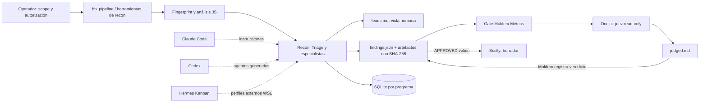

# Arquitectura actual de Mulderx

## Vista general

## Componentes implementados

### Entradas y reconocimiento

- `scripts/bb_pipeline.py`: pide confirmación, normaliza dominio/scope,
  ejecuta subdomain discovery, fingerprint y análisis JS opcional. Un host
  exacto no incluye subdominios; para incluirlos se declara `*.example.com`.
- `scripts/scope_policy.py`: política común de host, IDNA, URL HTTP(S),
  wildcard estricto y redirecciones contenidas al scope.
- `scripts/recon_fingerprint_v3.6_handoff_slim.py`: fingerprint activo,
  tech checks, análisis de assets y handoff; las redirecciones salen del scope
  y se bloquean.
- `scripts/sourcemap_recon.py` y `scripts/wayback_js_recon.py`: requieren
  confirmación interactiva o `--yes`, y scope exacto/wildcard explícito.
  Wayback consulta el archive; la descarga live se mantiene dentro del scope.

### Análisis de JavaScript

- `js_analyzer_v4_8.py` agrega análisis heurístico de endpoints, tecnologías,
  secretos y señales de seguridad sobre archivos locales.
- `taint_tracker.py` es un rastreador regex por archivo, no un parser AST ni
  análisis de flujo de control.
- `module_graph.py`/`module_graph_parcel.py` reconstruyen formatos concretos,
  pero requieren dependencias opcionales no instaladas en el entorno auditado.
- `sourcemap_recon.py` extrae sourcemaps dentro del scope declarado;
  `wayback_js_recon.py` compara JS histórico y actual cuando se autoriza.

### Agentes y proveedores

- `AGENTS.md` y `CLAUDE.md` expresan reglas comunes y ruteo.
- `.claude/agents/` contiene especialistas Claude; `.codex/agents/` se
  mantiene mediante `scripts/sync_codex_agents.py`.
- `.claude/skills/` es la fuente canónica. `.agents/skills/` son entradas
  completos Codex. `scripts/sync_codex_skills.py` valida que no haya stubs.
- `agents/<rol>/AGENT.md` versiona contratos de roles para el workflow
  Hermes. `scripts/hermes_swarm.sh` es un wrapper de Kanban; no constituye un
  runtime común ni actualiza los `SOUL.md` instalados en WSL.
- `orchestrator.py` sigue ejecutable, pero `USAGE.md` lo clasifica como
  heredado. Conserva riesgo de permisos amplios documentado en la auditoría.

### Evidencia, memoria y etapas

- `scripts/evidence_store.py` crea y valida hallazgos en `findings.json`.
  Exige campos, cadena de estados, evidencia mínima, hashes, impacto y Q1–Q3.
- `scripts/mulderx_metrics.py` registra snapshots concurrentes de manera
  atómica. El gate de judge exige `CONFIRMED` estructurado; reporter exige
  `APPROVED` estructurado.
- `scripts/research_memory.py` guarda activos, tecnologías, hipótesis,
  pruebas, falsos positivos, scope y relaciones en SQLite dentro del
  workspace de un programa. El `program-id` evita reutilizar la misma base con
  otra identidad.
- Markdown se conserva para lectura y revisión; no es la fuente de estado de
  los gates.

## Límites de confianza

Las respuestas HTTP, archivos del target y artefactos JS son datos no
confiables. Las skills lo instruyen, mientras que el filtro de scope y los
redirect guards se aplican en código en las rutas modificadas. La mayoría de
los otros límites del agente sigue dependiendo de prompts y permisos del
runtime. Los hashes protegen integridad posterior, no autentican el origen de
una captura. Claude/Codex/Hermes no comparten todavía un formato común de task,
cancelación o resultado.
